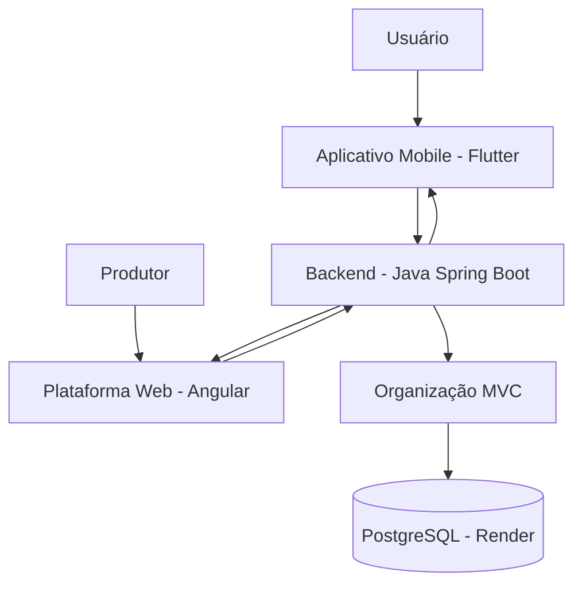
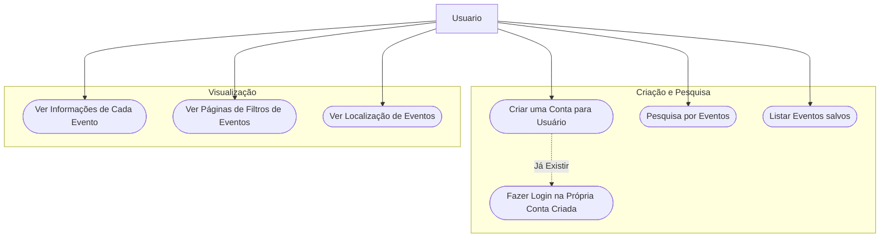
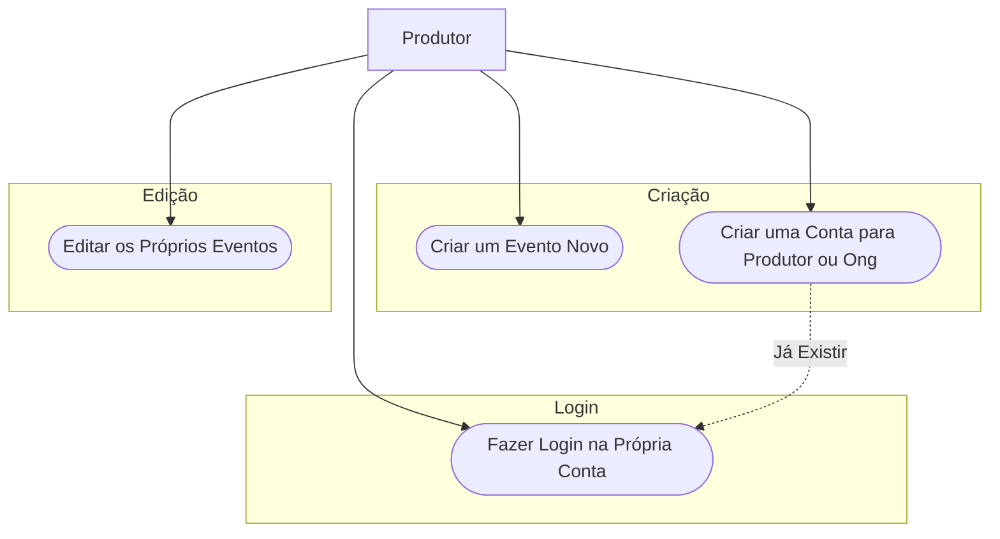
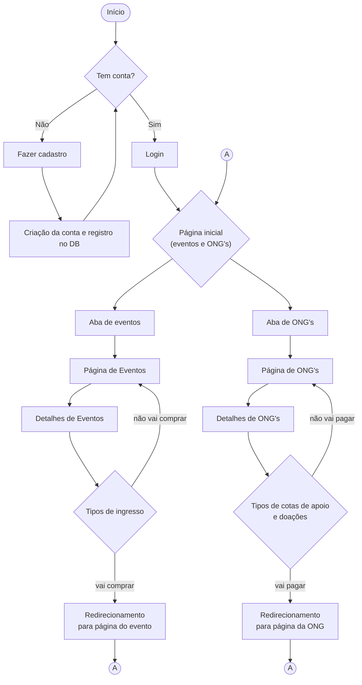
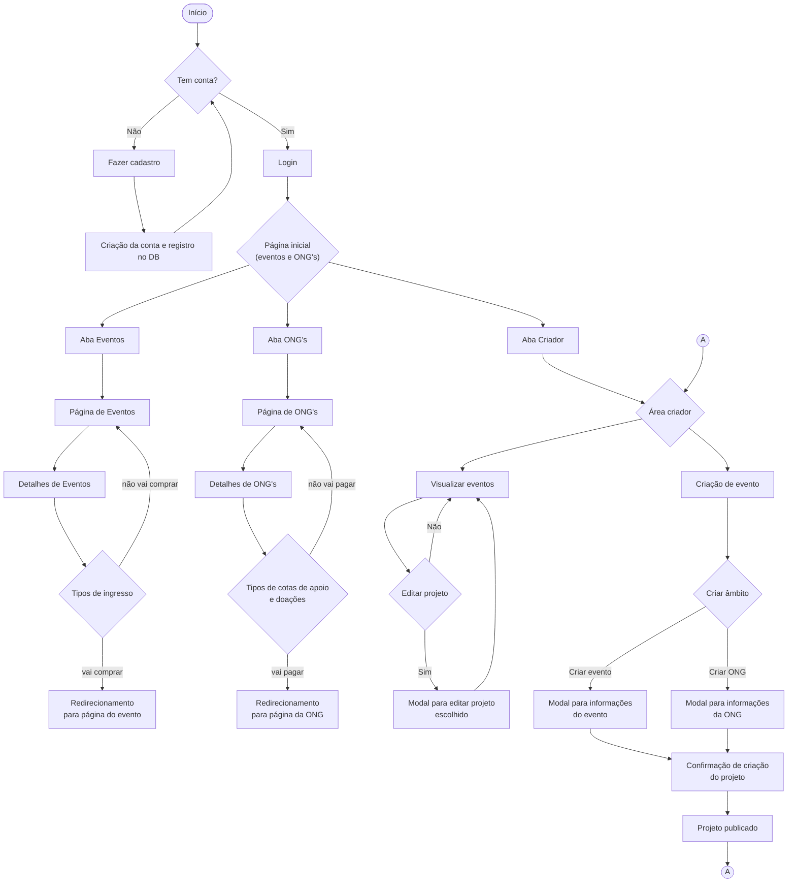
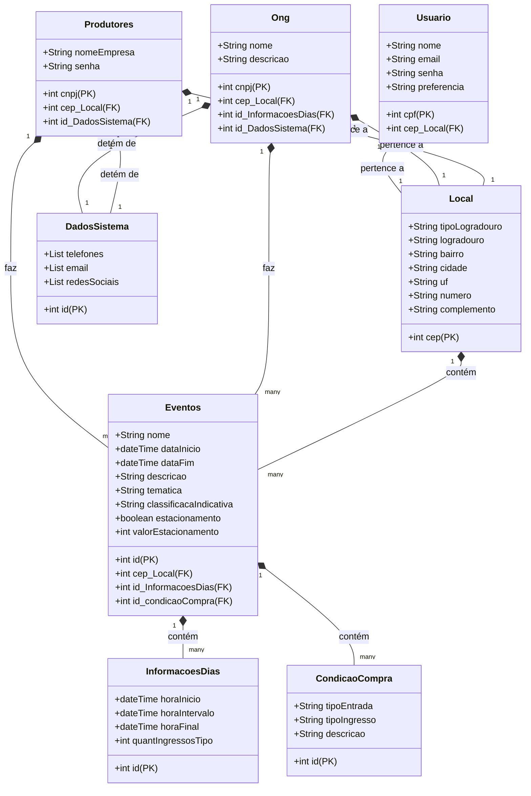

# Documentação da Estruturação da Plataforma de Divulgação de Eventos
Sistema de Descoberta, Divulgação e Organização de Eventos
**Padrão de referência:** ISO/IEC/IEEE 29148:2018  
**Versão:** 1.0.5  
**Data:** 2026-11-24  
**Autor:** Ana Luiza Pelisson Dore, Bárbara de Oliveira Cruz, Lucas Combinato Gato  

## 1. Introdução
### 1.1 Propósito
Este documento tem como propósito descrever, organizar e padronizar os requisitos, funcionalidades, estrutura e arquitetura planejada para o desenvolvimento da plataforma de divulgação e descoberta de eventos.
*A documentação busca:*
* Definir as funcionalidades e os objetivos do sistema;
* Estabelecer os requisitos funcionais e não funcionais;
* Padronizar o entendimento entre os integrantes da equipe e o professor/mediador;
* Documentar a estrutura lógica, técnica e organizacional da aplicação;
* Orientar o desenvolvimento, os testes e a validação do sistema.

### 1.2 Escopo
A plataforma tem como objetivo centralizar a divulgação e a descoberta de eventos, conectando usuários interessados em atividades culturais, musicais, sociais, educacionais, de entretenimento e outras categorias a produtores, empresas e organizações responsáveis pela realização desses eventos. O sistema será dividido principalmente em duas plataformas: Mobile, destinada principalmente aos usuários que desejam explorar e acompanhar eventos, e Web, voltada principalmente aos produtores, que poderão cadastrar, divulgar e administrar seus eventos.  

#### **O sistema permitirá:**  
- Cadastro e autenticação de usuários e produtores;
- Diferenciação de perfis e funcionalidades;
- Personalização das preferências de eventos;
- Pesquisa e filtragem de eventos;
- Visualização detalhada de eventos;
- Consulta de localização dos eventos;
- Cadastro, publicação, edição e gerenciamento de eventos;
- Organização de eventos por categorias e temáticas;
- Salvamento de eventos para acompanhamento;
- Notificações sobre alterações em eventos salvos;
- Cadastro e divulgação de ONGs e suas ações;
- Personalização da identidade visual dos produtores;
- Redirecionamento para plataformas externas de inscrição ou compra de ingressos;
- Organização e apresentação de eventos de acordo com os interesses dos usuários.

#### **Objetivos do sistema**
1. Facilitar a descoberta de eventos por meio de uma plataforma centralizada;
2. Melhorar a comunicação entre produtores e público interessado;
3. Permitir que produtores divulguem seus eventos de maneira organizada;
4. Facilitar o acesso às informações relevantes sobre eventos;
5. Auxiliar usuários a encontrar eventos de acordo com seus interesses;
6. Reduzir a dificuldade de encontrar informações dispersas sobre atividades e eventos;
7. Oferecer uma experiência de navegação organizada, acessível e intuitiva.

### 1.3 Definições e Acrônimos
#### Tabela de Termos e Definições
| Termo | Definição
| --- | --- | 
| Usuário | Pessoa que utiliza a plataforma para pesquisar, visualizar, salvar e acompanhar eventos.
| Produtor | Pessoa, empresa ou organização responsável pela criação e divulgação de eventos na plataforma.
| ONG | Organização não governamental que poderá divulgar suas ações, campanhas e eventos.
| Evento | Atividade, encontro, apresentação, ação, palestra ou outra programação divulgada na plataforma.
| Ingresso | Modalidade de acesso ou participação em um evento, podendo possuir valor, requisitos e benefícios específicos.
| Identidade visual | Elementos visuais utilizados para representar um produtor ou organização, incluindo logotipo e cores.
| Preferências | Categorias e interesses selecionados pelo usuário para personalizar a descoberta de eventos.
| Notificação | Aviso exibido ao usuário sobre alterações ou informações relevantes de eventos acompanhados.
| CRUD | Operações de Create, Read, Update e Delete, correspondentes à criação, leitura, atualização e exclusão de registros.
| MVC | Model-View-Controller, padrão de organização de software que separa responsabilidades entre modelo, visualização e controlador.
| API | Interface de comunicação entre sistemas ou componentes de software.
| DER | Diagrama Entidade-Relacionamento, utilizado para representar a estrutura de dados e os relacionamentos entre entidades.

#### Lista de Acrônimos

| Acrônimo | Significado
| --- | --- 
| RF | Requisito Funcional
| RNF | Requisito Não Funcional
| RN | Regra de Negócio
| UC | Use Case / Caso de Uso
| CA | Critério de Aceitação
| BD | Banco de Dados
| SQL | Structured Query Language
| MVC | Model-View-Controller
| API | Application Programming Interface
| DER | Diagrama Entidade-Relacionamento
| ONG | Organização Não Governamental
| CNPJ | Cadastro Nacional da Pessoa Jurídica
| CPF | Cadastro de Pessoas Físicas
| CEP | Código de Endereçamento Postal

### 1.4 Visão Geral do Documento
Este documento está organizado em:
- Introdução;
- Descrição Geral do Sistema;
- Organização e Estrutura do Sistema;
- Requisitos do Sistema;
- Regras de Negócio;
- Modelos e Diagramas do Sistema.

## 2. Descrição Geral do Sistema
### 2.1 Perspectiva do Sistema
O sistema será uma plataforma de divulgação e descoberta de eventos, composta por uma aplicação Mobile e uma aplicação Web, integradas a um backend responsável pelo processamento das informações e comunicação com o banco de dados.
- A aplicação Mobile será destinada principalmente aos usuários comuns, permitindo a pesquisa, filtragem, visualização, localização e acompanhamento de eventos.
- A aplicação Web será destinada principalmente aos produtores, permitindo o cadastro, gerenciamento, publicação e edição de eventos, além da personalização de suas páginas e identidade visual.
- Ambas as plataformas utilizarão uma API desenvolvida em Java com Spring Boot, responsável pela comunicação com o banco de dados PostgreSQL, processamento das solicitações e aplicação das regras de negócio.

**Diagrama Geral de Funcionamento**

A comunicação entre as aplicações ocorrerá por meio de requisições à API, que processará as informações, consultará ou atualizará o banco de dados e retornará os resultados às interfaces correspondentes.


### 2.2 Arquitetura de Páginas e Estrutura de Arquivos
A aplicação será organizada em duas interfaces principais, Mobile e Web, e um backend compartilhado.

**Aplicação Mobile - Flutter**  
A aplicação Mobile será voltada principalmente aos usuários comuns, permitindo a descoberta e o acompanhamento de eventos.
- Tela
- Responsabilidade
- Cadastro
- Permitir a criação de contas, preenchimento de dados pessoais e seleção de preferências.
- Login
- Permitir o acesso a contas existentes por meio de email e senha.
- Tela Inicial
- Apresentar eventos relevantes, eventos gratuitos, temáticas, pesquisa e recomendações.
- Tela Temática
- Apresentar eventos organizados por categorias, como shows, palestras, eventos culturais e ações sociais.
- Página de Eventos
- Apresentar a listagem de eventos disponíveis.
- Detalhes do Evento
- Apresentar informações completas sobre um evento, incluindo localização, datas, horários, descrição, ingressos e informações do produtor.
- Eventos Salvos
- Apresentar os eventos que o usuário salvou para acompanhar posteriormente.
- Perfil do Usuário
- Permitir a visualização e edição de dados pessoais e preferências.
- Notificações
- Apresentar avisos relacionados aos eventos acompanhados pelo usuário.

**Aplicação Web - Angular**  
A aplicação Web será destinada principalmente aos produtores, permitindo o gerenciamento de seus eventos e informações.
- Tela
- Responsabilidade
- Cadastro
- Permitir o cadastro de produtores e organizações.
- Login
- Permitir o acesso à conta do produtor.
- Área do Criador
- Apresentar os eventos criados, publicados e administrados pelo produtor.
- Criação de Evento
- Permitir o preenchimento das informações necessárias para cadastrar um evento.
- Edição de Evento
- Permitir a alteração das informações de eventos previamente cadastrados.
- Visualização de Eventos
- Apresentar os eventos criados pelo produtor e seus respectivos estados.
- Perfil do Produtor
- Permitir a visualização e edição de informações da empresa ou organização.
- Identidade Visual
- Permitir a personalização da apresentação do produtor por meio de logotipo e cores.

**Backend - Java e Spring Boot**
O backend será responsável por:
- Receber requisições das aplicações Mobile e Web;
- Processar as informações enviadas;
- Validar dados;
- Aplicar regras de negócio;
- Realizar operações no banco de dados;
- Gerenciar contas, eventos, preferências e notificações;
- Retornar respostas às aplicações;
- Disponibilizar endpoints para comunicação entre as interfaces e o sistema.
- Organização MVC

**O backend será organizado conforme o padrão MVC:**
- Componente
- Responsabilidade
- Model → Representar os dados, entidades e estruturas relacionadas ao sistema.
- View → Representar a camada de apresentação ou resposta das informações. Nas aplicações separadas, a apresentação é realizada pelo Angular e Flutter.
- Controller → Receber, organizar e direcionar as requisições realizadas pelas aplicações.

A organização do backend também utilizará a camada de serviços e a camada de persistência para separar responsabilidades e facilitar a manutenção.  
#### Estrutura inicial de organização do backend
```
backend/  
├── controller/  
├── service/  
├── repository/  
├── model/  
├── dto/  
├── config/  
└── exception/
```
#### Estrutura inicial de organização da Web  
```
web/  
├── src/  
│   ├── app/  
│   │   ├── components/  
│   │   ├── pages/  
│   │   ├── services/  
│   │   ├── models/  
│   │   └── routes/  
│   └── assets/  
```
#### Estrutura inicial de organização do Mobile  
```
mobile/  
├── lib/  
│   ├── screens/  
│   ├── widgets/  
│   ├── models/  
│   ├── services/  
│   ├── controllers/  
│   └── utils/
```


As estruturas apresentadas são propostas de organização e poderão ser ajustadas durante o desenvolvimento.
### 2.3 Classes de Usuários
| Usuário | Descrição | Principais Responsabilidades
| --- | --- | --- 
| Usuário Comum | Pessoa que utiliza a aplicação Mobile para encontrar e acompanhar eventos. | Pesquisar, filtrar, visualizar, salvar e acompanhar eventos.
| Produtor | Pessoa, empresa ou organização responsável pela divulgação e administração de eventos. | Criar, publicar, editar e gerenciar eventos e informações de perfil.
| ONG | Organização não governamental que poderá divulgar ações, campanhas e eventos sociais. | Administrar informações institucionais e divulgar eventos ou ações.

As funcionalidades disponíveis serão diferenciadas de acordo com o perfil cadastrado.
As ONGs serão tratadas como organizações capazes de divulgar suas ações e eventos. A forma definitiva de representação de ONG no banco de dados será definida durante a modelagem.
### 2.4 Ambiente Operacional
| Componente | Tecnologia | 
|--- | --- |
|Organização de Software | MVC | 
| Backend | Java
| Framework Backend | Spring Boot | 
| Módulos Backend| Spring Web e Spring Data JPA | 
| Frontend Web | Angular
| Mobile | Dart e Flutter | 
| Banco de Dados | PostgreSQL
| Hospedagem do Banco de Dados | Render
| Plataforma de Programação | Visual Studio
| Documentação | Markdown e Google Documents

**Ambiente de utilização**
**Mobile:** dispositivos móveis compatíveis com a aplicação Flutter.
**Web:** navegadores modernos compatíveis com a aplicação Angular.
**Backend:** ambiente capaz de executar a aplicação Java com Spring Boot.
**Banco de Dados:** PostgreSQL hospedado no Render.
### 2.5 Restrições
A aplicação será dividida entre Mobile e Web, com funcionalidades específicas para cada plataforma.
- O Mobile será destinado principalmente aos usuários comuns.
A Web será destinada principalmente aos produtores.
O sistema dependerá da comunicação com o backend para consultar, cadastrar, editar e atualizar informações.
O sistema dependerá da disponibilidade do banco de dados PostgreSQL.
A compra de ingressos e pagamentos não serão processados diretamente pela plataforma.
O sistema utilizará links externos fornecidos pelos produtores para direcionamento de inscrições ou compras, quando aplicável.
A divulgação de eventos dependerá das informações cadastradas pelos produtores.
A disponibilidade da plataforma poderá ser limitada ao período de apresentações, demonstrações e verificações do projeto.
### 2.6 Suposições
Os usuários possuem acesso à internet para utilizar a plataforma.
Os produtores são responsáveis pela veracidade das informações cadastradas em seus eventos.
Os usuários possuem dispositivos compatíveis com a aplicação Mobile.
Os produtores possuem acesso a um navegador compatível com a aplicação Web.
Os produtores poderão fornecer links externos para inscrição ou compra de ingressos.
Os eventos serão organizados por categorias e temáticas para facilitar a descoberta.
O banco de dados PostgreSQL estará configurado e disponível para comunicação com o backend.
As aplicações Mobile e Web utilizarão o mesmo backend para acessar e modificar os dados.
As funcionalidades de localização dependerão das informações de endereço fornecidas pelos responsáveis pelos eventos.
### 2.7 Instalação e Execução
Pré-requisitos
[Preencher após a finalização do desenvolvimento.]
Instalação
[Preencher após a finalização do desenvolvimento.]
Configuração
[Preencher após a finalização do desenvolvimento.]
Execução
[Preencher após a finalização do desenvolvimento.]
Acesso ao Sistema
[Preencher após a finalização do desenvolvimento.]

## 3. Organização e Estrutura do Sistema
### 3.1 Divisão dos Módulos e Funcionalidades
O sistema será organizado em módulos que representam as principais funcionalidades da plataforma.

| Módulo |  Descrição
| --- | ---
| Autenticação | Gerenciamento de cadastro, login e acesso às contas.
| Usuários | Gerenciamento de dados pessoais, perfil e preferências.
| Produtores | Gerenciamento de informações empresariais e organizacionais.
| Eventos | Cadastro, edição, publicação e gerenciamento de eventos.
| Pesquisa e Filtros | Pesquisa e filtragem de eventos por categorias e características.
| Temáticas | Organização e apresentação de eventos por categorias.
| Eventos Salvos | Gerenciamento dos eventos que os usuários desejam acompanhar.
| Notificações | Gerenciamento de avisos relacionados aos eventos acompanhados.
| Identidade Visual | Personalização visual dos perfis dos produtores.
| ONGs | Organização e divulgação de ações, campanhas e eventos sociais.
| Localização | Gerenciamento e apresentação de endereços e informações geográficas dos eventos.
| Ingressos e Inscrições | Apresentação das modalidades, valores, requisitos e links externos de compra ou inscrição.

### 3.2 Organização Lógica do Sistema
O sistema será organizado de forma que cada aplicação se comunique com o backend por meio de uma API.
**Fluxo lógico geral**
- O usuário ou produtor acessa a aplicação correspondente ao seu perfil.
- A aplicação realiza uma requisição ao backend.
- O Controller recebe a requisição.
- O Service processa a operação e aplica as regras de negócio.
- O Repository realiza as operações de persistência necessárias.
- O banco de dados retorna os resultados.
- O backend envia uma resposta à aplicação.
- A interface apresenta as informações atualizadas ao usuário.

**Organização lógica do Backend**
| Camada | Responsabilidade
| --- | --- 
| Controller | Receber requisições e disponibilizar endpoints.
| Service | Processar operações, validar informações e aplicar regras de negócio.
| Repository | Realizar operações de consulta, inserção, atualização e exclusão no banco de dados.
| Model | Representar as entidades e estruturas de dados.
| DTO | Organizar os dados utilizados na comunicação entre as aplicações e o backend.
| Config | Centralizar configurações da aplicação.
| Exception | Organizar o tratamento de erros e exceções.

### 3.3 Estrutura do Banco de Dados
O banco de dados será desenvolvido utilizando PostgreSQL e hospedado no Render.
A estrutura será organizada de forma relacional, permitindo a integração entre usuários, produtores, eventos, locais, ingressos, notificações, preferências e demais informações necessárias para o funcionamento da plataforma.

**Entidades previstas**
| Entidade | Descrição
| --- | --- 
| Usuario | Armazena os dados pessoais e preferências dos usuários.
| Produtor | Armazena informações das empresas e responsáveis pela divulgação de eventos.
| ONG | Representa organizações não governamentais, caso sejam modeladas separadamente.
| Evento | Armazena as informações gerais dos eventos.
| Local | Armazena informações de endereço.
| InformacoesDia | Armazena horários e informações de programação de cada dia do evento.
| TipoIngresso | Armazena os tipos, valores, requisitos e benefícios dos ingressos.
| DadosContato | Armazena informações de comunicação e redes sociais.
| IdentidadeVisual | Armazena as configurações visuais de produtores e organizações.
| EventoSalvo | Relaciona usuários a eventos salvos.
| Notificacao | Armazena notificações destinadas aos usuários.
| Tematica | Representa as categorias e temáticas utilizadas na organização dos eventos.
| PreferenciaUsuario | Relaciona usuários às temáticas e preferências selecionadas.

**Atributos preliminares**
Usuario
Atributo
Descrição
id
Identificador único do usuário.
cpf
Documento de identificação, caso exigido.
nome
Nome completo do usuário.
email
Email utilizado para identificação e login.
senha
Credencial armazenada de forma segura.
local_id
Referência ao endereço, caso necessário.

Produtor
Atributo
Descrição
id
Identificador único do produtor.
cnpj
Identificação da empresa, quando aplicável.
nomeEmpresa
Nome da empresa ou organização.
email
Email de contato e login.
senha
Credencial armazenada de forma segura.
local_id
Referência ao endereço.
dadosContato_id
Referência às informações de contato.
identidadeVisual_id
Referência às configurações visuais.

#### **ONG**
| **Atributo** | **Descrição** |
| --- | --- |
| id | Identificador da organização. |
| cnpj | Identificação da organização, quando aplicável. |
| nome | Nome da ONG. |
| descricao | Descrição institucional. |
| local_id | Referência ao endereço. |
| dadosContato_id | Referência às informações de contato. |
| identidadeVisual_id | Referência às configurações visuais. |

#### **Evento**
| **Atributo** | **Descrição** |
| --- | --- |
| id | Identificador único do evento. |
| nome | Nome do evento. |
| descricao | Descrição e informações gerais. |
| dataInicio | Data de início do evento. |
| dataFim | Data de encerramento do evento. |
| tematica_id | Referência à temática. |
| classificacaoIndicativa | Classificação indicativa do evento. |
| estacionamento | Indica se há estacionamento. |
| valorEstacionamento | Valor do estacionamento, quando aplicável. |
| local_id | Referência ao local do evento. |
| produtor_id | Referência ao responsável pelo evento. |
| status | Situação de publicação do evento. |

#### **Local**
| **Atributo** | **Descrição** |
| --- | --- |
| id | Identificador único do endereço. |
| cep | Código de Endereçamento Postal. |
| tipoLogradouro | Tipo do logradouro. |
|  logradouro | Nome do logradouro. |
| bairro | Bairro. |
| cidade | Cidade. |
| uf    | Unidade Federativa.|
| numero | Número do endereço. |
| complemento | Complemento do endereço. |

### **InformacoesDia**  
| **Atributo** | **Descrição** |   
| --- | --- |
| id | Identificador da programação. |  
| evento_id | Referência ao evento. |  
| data | Data da programação. |  
| horaInicio | Horário de início. |  
| horaFinal | Horário de encerramento. |  

### **TipoIngresso**
| **Atributo** | **Descrição** |
| id | Identificador do tipo de ingresso.|
| evento_id | Referência ao evento. | 
| nome | Nome ou categoria do ingresso. |
| descricao | Descrição e requisitos. | 
| valor | Valor do ingresso, quando aplicável. | 
| quantidadeDisponivel |Quantidade informada pelo produtor, quando aplicável. | 
| beneficios | Benefícios associados ao ingresso. | 
| linkCompra | Link externo de compra ou inscrição, quando aplicável. | 

### DadosContato 
| **Atributo** | **Descrição** |
| --- | --- |
| id | Identificador das informações de contato.
| email | Email de contato.
| telefone | Telefone de contato.
| redesSociais | Informações sobre redes sociais.
| site | Site oficial, quando aplicável.

IdentidadeVisual
Atributo
Descrição
id
Identificador da identidade visual.
logo
Referência ao logotipo ou arquivo da imagem.
corPrincipal
Cor principal.
corSecundaria
Cor secundária.
corDestaque
Cor de destaque.
usarIdentidadePadrao
Indica a utilização da identidade visual padrão da plataforma.

EventoSalvo
Atributo
Descrição
id
Identificador do registro.
usuario_id
Referência ao usuário.
evento_id
Referência ao evento.
dataSalvamento
Data em que o evento foi salvo.

Notificacao
Atributo
Descrição
id
Identificador da notificação.
usuario_id
Referência ao usuário destinatário.
evento_id
Referência ao evento relacionado.
mensagem
Conteúdo da notificação.
dataCriacao
Data e hora da criação.
lida
Indica se a notificação foi lida.

Tematica
Atributo
Descrição
id
Identificador da temática.
nome
Nome da categoria.
descricao
Descrição da temática.

PreferenciaUsuario
Atributo
Descrição
id
Identificador da preferência.
usuario_id
Referência ao usuário.
tematica_id
Referência à temática selecionada.

Os atributos apresentados representam uma proposta inicial de estrutura. Os tipos de dados, chaves, relacionamentos, restrições e possíveis ajustes deverão ser definidos durante a modelagem definitiva do banco de dados.

## 4. Requisitos do Sistema
### 4.1 Requisitos Funcionais (RF)
Os requisitos funcionais descrevem as funcionalidades que o sistema deverá oferecer aos usuários e produtores.
ID
Requisito
Descrição
Critérios de Aceitação
RF-01
Cadastro de Usuários
Permitir que usuários comuns criem contas informando seus dados pessoais, email, senha e preferências.
O usuário deverá conseguir preencher e enviar o formulário. O sistema deverá validar os dados e registrar a conta.
RF-02
Cadastro de Produtores
Permitir o cadastro de empresas e organizações responsáveis pela divulgação de eventos.
O produtor deverá informar os dados exigidos pelo cadastro e conseguir criar uma conta.
RF-03
Login
Permitir que usuários e produtores acessem suas contas utilizando email e senha.
O sistema deverá validar as credenciais e permitir o acesso correspondente ao perfil. Credenciais inválidas deverão gerar uma mensagem de erro.
RF-04
Gerenciamento de Perfil
Permitir a visualização e atualização dos dados pessoais ou empresariais.
O usuário ou produtor deverá conseguir visualizar e alterar os dados permitidos.
RF-05
Preferências de Eventos
Permitir que usuários selecionem categorias e interesses para personalizar a descoberta de eventos.
As preferências deverão ser armazenadas e utilizadas para organizar ou filtrar os eventos apresentados.
RF-06
Pesquisa de Eventos
Permitir que usuários pesquisem eventos disponíveis na plataforma.
O sistema deverá apresentar eventos correspondentes à pesquisa realizada.
RF-07
Filtragem de Eventos
Permitir a filtragem de eventos por características como preço, temática, data e modalidade.
O sistema deverá apresentar resultados compatíveis com os filtros selecionados.
RF-08
Visualização de Eventos
Permitir que usuários consultem as informações detalhadas de eventos publicados.
A página deverá apresentar as informações disponíveis do evento, incluindo data, horário, localização, descrição e ingressos.
RF-09
Organização Temática
Permitir a organização e visualização de eventos por categorias e temáticas.
O usuário deverá conseguir acessar categorias e visualizar os eventos relacionados.
RF-10
Cadastro de Eventos
Permitir que produtores criem eventos preenchendo as informações necessárias.
O produtor deverá conseguir cadastrar um evento com os dados obrigatórios.
RF-11
Publicação de Eventos
Permitir que produtores publiquem eventos cadastrados.
Eventos publicados deverão ficar disponíveis para visualização pelos usuários.
RF-12
Edição de Eventos
Permitir que produtores alterem informações de eventos previamente cadastrados.
O produtor deverá conseguir atualizar os dados de um evento de sua responsabilidade.
RF-13
Exclusão ou Despublicação
Permitir que produtores removam ou despubliquem eventos próprios.
O sistema deverá permitir a operação somente sobre eventos de responsabilidade do produtor e atualizar sua disponibilidade.
RF-14
Eventos Salvos
Permitir que usuários salvem eventos para acompanhar posteriormente.
O usuário deverá conseguir salvar, visualizar e remover eventos de sua lista.
RF-15
Notificações
Informar aos usuários sobre alterações relevantes em eventos salvos.
Alterações relevantes deverão gerar notificações para usuários que acompanham o evento.
RF-16
Localização de Eventos
Permitir a visualização de informações de localização dos eventos.
O sistema deverá apresentar os dados de localização cadastrados.
RF-17
Informações de Ingressos
Permitir a apresentação de tipos de ingresso, valores, requisitos, benefícios e links externos.
Os usuários deverão conseguir visualizar as informações cadastradas pelo produtor.
RF-18
Redirecionamento de Compra ou Inscrição
Permitir o redirecionamento para links externos de compra ou inscrição.
Ao selecionar o link disponibilizado, o usuário deverá ser direcionado ao endereço externo informado.
RF-19
Cadastro de ONGs
Permitir que ONGs disponibilizem suas informações e divulguem ações e eventos.
A organização deverá conseguir cadastrar e disponibilizar suas informações e eventos conforme as funcionalidades implementadas.
RF-20
Identidade Visual
Permitir que produtores utilizem a identidade visual padrão ou personalizem sua apresentação.
O produtor deverá conseguir selecionar a identidade padrão ou cadastrar elementos de personalização permitidos.
RF-21
Gerenciamento de Notificações
Permitir que usuários visualizem e marquem notificações como lidas.
O usuário deverá conseguir acessar as notificações e identificar as que foram lidas ou não.

4.2 Requisitos Não Funcionais (RNF)
Os requisitos não funcionais descrevem características de qualidade, desempenho, organização e funcionamento do sistema.
ID
Requisito
Descrição
RNF-01
Desempenho
O sistema deverá buscar proporcionar um tempo de resposta de até 3 segundos entre páginas, considerando condições adequadas de conexão e operação.
RNF-02
Disponibilidade
O sistema deverá estar disponível durante os períodos de apresentação, execução demonstrativa e verificações previstas para o projeto.
RNF-03
Compatibilidade
A aplicação deverá funcionar em dispositivos móveis compatíveis com Flutter e navegadores modernos compatíveis com Angular.
RNF-04
Organização de Código
O sistema deverá possuir código organizado e separado por responsabilidades, seguindo a arquitetura MVC no backend.
RNF-05
Manutenção
A estrutura deverá permitir a manutenção, atualização e expansão das funcionalidades.
RNF-06
Segurança
O sistema deverá proteger o acesso às funcionalidades e informações de acordo com o perfil de usuário. Senhas deverão ser armazenadas de forma segura.
RNF-07
Integridade dos Dados
O sistema deverá manter a consistência dos registros e relacionamentos no banco de dados.
RNF-08
Usabilidade
As interfaces deverão apresentar informações de maneira organizada, legível e intuitiva.
RNF-09
Privacidade
Os dados pessoais deverão ser utilizados e armazenados de forma adequada, considerando os princípios de proteção e privacidade de dados.
RNF-10
Comunicação
As aplicações Mobile e Web deverão se comunicar com o backend por meio de interfaces de comunicação definidas.
RNF-11
Persistência
Os dados cadastrados deverão ser armazenados no PostgreSQL, permitindo sua recuperação e atualização.


## 5. Regras de Negócio (RN)
ID
Regra de Negócio
Descrição
RN-01
Diferenciação de Contas
O sistema deverá diferenciar usuários comuns e produtores, disponibilizando funcionalidades de acordo com o perfil cadastrado.
RN-02
Responsabilidade pelos Eventos
O produtor será responsável pelas informações cadastradas e pela atualização de seus eventos.
RN-03
Gerenciamento de Eventos
Um produtor poderá editar ou despublicar somente eventos de sua responsabilidade.
RN-04
Publicação
Eventos publicados deverão estar disponíveis para consulta pelos usuários, conforme os filtros e categorias da plataforma.
RN-05
Eventos Salvos
Um usuário poderá salvar eventos para acompanhamento e deverá ter acesso à sua própria lista de eventos salvos.
RN-06
Notificações de Alteração
Alterações relevantes em eventos salvos deverão gerar avisos aos usuários que acompanham esses eventos.
RN-07
Compra e Inscrição
A plataforma não realizará pagamentos ou vendas diretamente. A compra ou inscrição deverá ocorrer por meio de links externos disponibilizados pelo produtor, quando aplicável.
RN-08
Informações de Ingressos
Os produtores serão responsáveis por informar corretamente os tipos, valores, requisitos, benefícios e links relacionados aos ingressos.
RN-09
Identidade Visual
O produtor poderá utilizar a identidade visual padrão da plataforma ou personalizar sua apresentação utilizando os elementos disponibilizados.
RN-10
Identidade Visual Padrão
Caso o produtor não personalize sua identidade visual, será utilizada a apresentação padrão da plataforma.
RN-11
ONGs
ONGs poderão divulgar suas informações, ações e eventos conforme as funcionalidades disponibilizadas.
RN-12
Preferências
As preferências selecionadas pelos usuários poderão ser utilizadas para organizar e filtrar os eventos apresentados.
RN-13
Filtros
Os filtros deverão apresentar resultados compatíveis com as características selecionadas pelo usuário.
RN-14
Classificação Indicativa
A classificação indicativa informada pelo produtor deverá ser apresentada na página do evento para consulta dos usuários.
RN-15
Localização
Os produtores deverão informar os dados de localização necessários para que os usuários identifiquem onde o evento ocorrerá.
RN-16
Estacionamento
As informações sobre estacionamento e valores, quando existentes, deverão ser informadas pelo produtor e exibidas na página do evento.
RN-17
Cancelamento ou Despublicação
Caso um evento seja despublicado ou cancelado, sua disponibilidade para os usuários deverá ser atualizada e os usuários que o acompanham deverão ser notificados, conforme a funcionalidade de notificações.


## 6. Modelos do Sistema (Diagramas)
### 6.1.1 Diagrama de Casos de Uso - Usuário
O diagrama de casos de uso representa as principais funcionalidades disponíveis na plataforma de acordo com os perfis de usuários.


### 6.1.2 Diagrama de Casos de Uso - Produtores



### 6.2 Diagrama de Sequência
Fluxo de Cadastro e Publicação de Evento
sequenceDiagram
    autonumber
    participant P as Produtor
    participant W as Web Angular
    participant C as Controller
    participant S as Service
    participant R as Repository
    participant DB as PostgreSQL

    P->>W: Preenche formulário de evento
    W->>C: Envia dados do evento
    C->>S: Solicita processamento
    S->>S: Valida informações
    S->>R: Solicita registro
    R->>DB: INSERT Evento
    DB-->>R: Registro persistido
    R-->>S: Evento registrado
    S-->>C: Retorna resultado
    C-->>W: Resposta da requisição
    W-->>P: Confirmação do cadastro
Fluxo de Pesquisa e Filtragem de Eventos
sequenceDiagram
    autonumber
    participant U as Usuário
    participant M as Mobile Flutter
    participant C as Controller
    participant S as Service
    participant R as Repository
    participant DB as PostgreSQL

    U->>M: Seleciona filtros ou pesquisa
    M->>C: Envia parâmetros de pesquisa
    C->>S: Solicita busca
    S->>R: Consulta eventos
    R->>DB: SELECT eventos filtrados
    DB-->>R: Resultados
    R-->>S: Eventos encontrados
    S-->>C: Retorna resultados
    C-->>M: Resposta
    M-->>U: Apresenta eventos
### 6.3 Diagrama de Fluxo Mobile
O fluxo Mobile representa o acesso dos usuários comuns à plataforma.

### 6.4 Diagrama de Fluxo Web
O fluxo Web representa o acesso dos produtores à plataforma para criação e gerenciamento de eventos.

### 6.5 Diagrama Entidade-Relacionamento (DER)
O diagrama abaixo representa uma proposta inicial de organização das entidades e relacionamentos do banco de dados.
A estrutura poderá sofrer ajustes durante a implementação, especialmente na definição de como ONGs, produtores, temáticas, preferências, contatos, identidade visual e programação diária serão representados.

### 6.6 Diagrama de Arquitetura MVC
[Inserir diagrama de arquitetura MVC após a finalização da estrutura de desenvolvimento.]

Considerações Finais
A plataforma busca facilitar a descoberta, divulgação e organização de eventos por meio de uma aplicação integrada, oferecendo funcionalidades específicas para usuários comuns, produtores e organizações.
A estrutura proposta combina aplicações Mobile e Web com um backend centralizado, possibilitando o compartilhamento de informações e a organização dos dados por meio de um banco de dados relacional.
A documentação estabelece a base para o desenvolvimento e a implementação das funcionalidades previstas, permitindo que a equipe organize as responsabilidades, mantenha a consistência entre os requisitos e acompanhe a evolução do projeto.
As definições que dependem da implementação, validação técnica ou decisões futuras da equipe poderão ser atualizadas conforme o desenvolvimento avance.