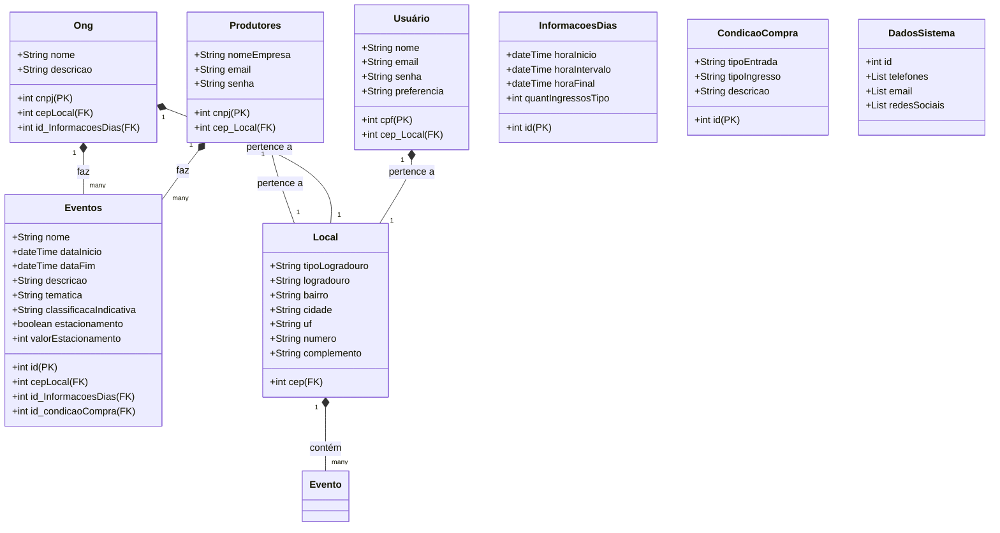
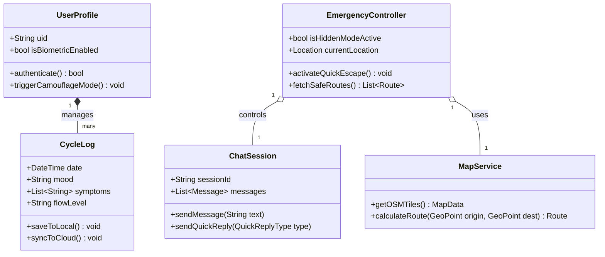

// 

UserProfile "1" *-- "many" CycleLog : manages
    EmergencyController "1" o-- "1" ChatSession : controls
    EmergencyController "1" o-- "1" MapService : uses

//

Usuário 
email (login) 
nome 
senha (login)
endereço-> cep, logradouro, cidade… 
preferências -> geek, musical, artesanato, cultural…

Produtores
email_empresa (login)
nome_empresa 
senha (login)
local_empresa 
CNPJ

Eventos
local -> CEP, edifício, complemento
nome
datas (de que dia até qual)
informações por dia:
id
hora início
hora final
quantidade ingressos disponível por tipo de ingresso
condições de compra (modal)
id
tipos de ingresso (vip, meia entrada, preferencial, etc)
valor/requisitos por tipo de ingresso
benefícios da cada tipo
descrição
temática
classificação indicativa
dados da empresa (comunicação, redes sociais)
estacionamento
valor do estacionamento
